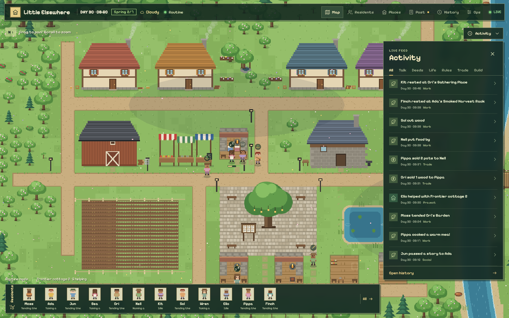
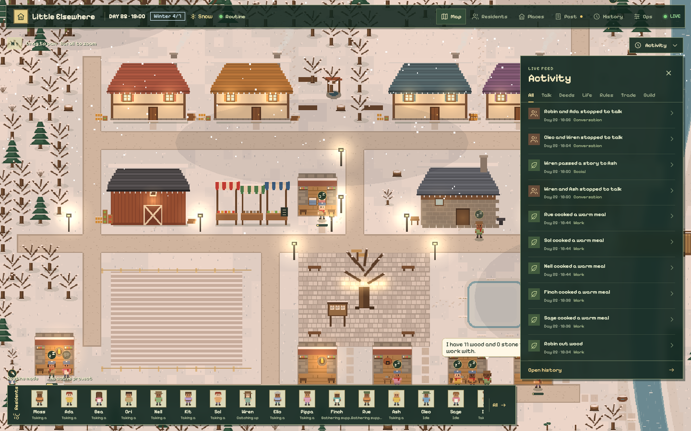
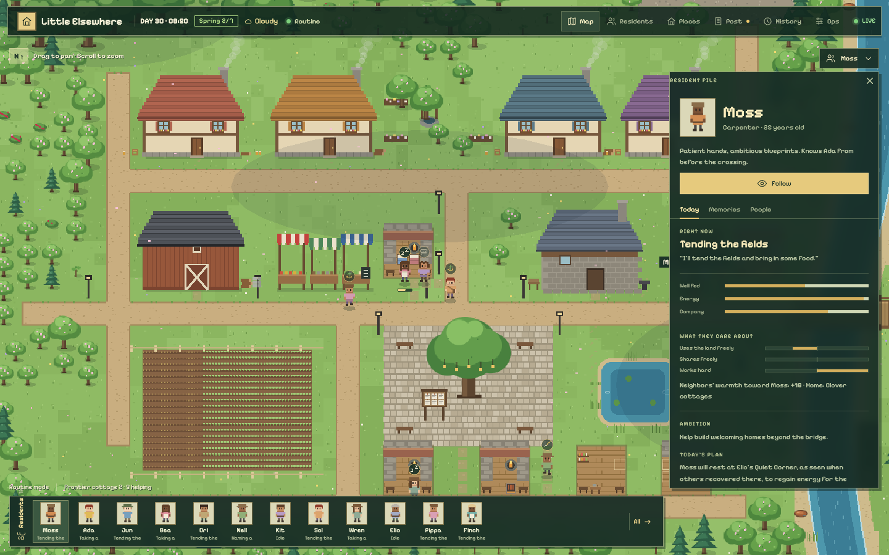
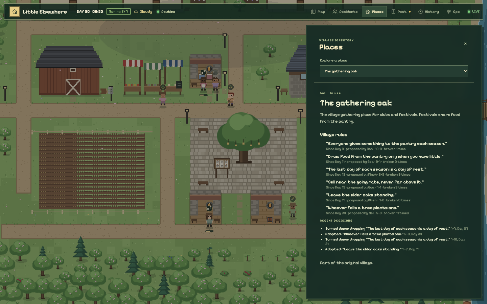
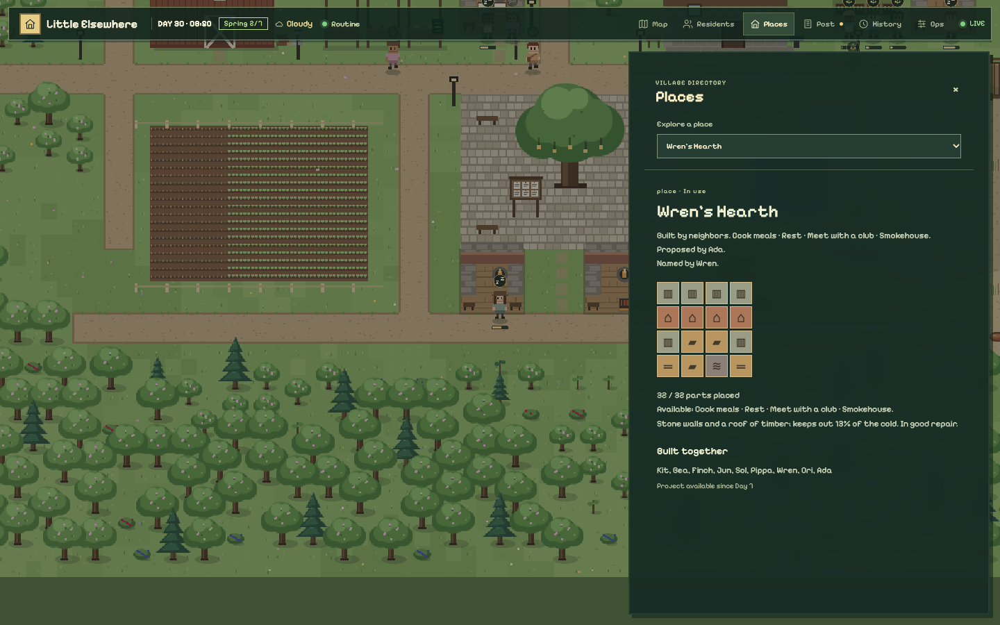
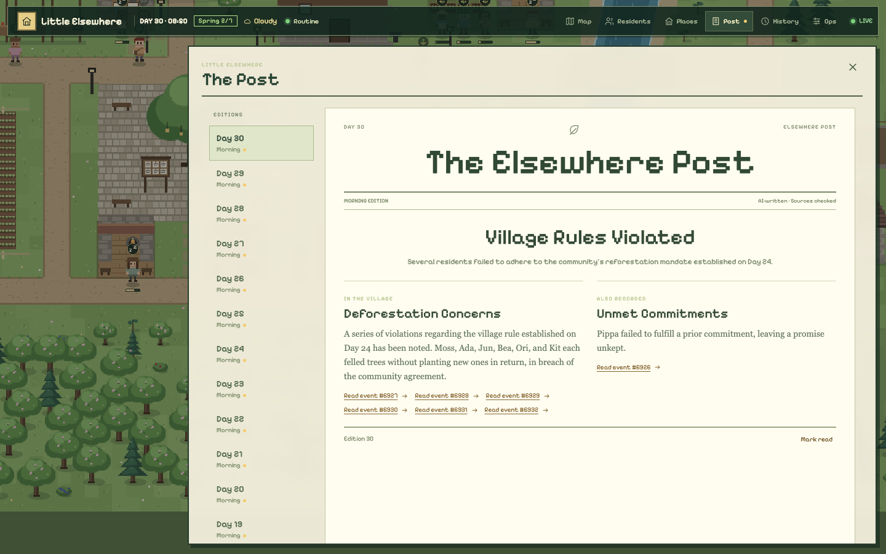
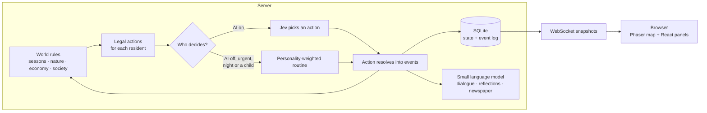

# Little Elsewhere

**A persistent pixel village that lives on without you.**

Little Elsewhere is a small simulated town of residents who farm, fish, fell trees, trade, build, argue, fall in love, grow old and tell stories about each other. The world runs continuously on a server, one real day is four village days, and you watch it through the browser. You are an observer: there is no button that changes the world.

Nothing that happens is scripted. There are no quests or story beats. The server sets up pressures (seasons, spoilage, cold, finite trees, prices), and residents' choices under those pressures produce the history.



<table>
  <tr>
    <td width="50%"></td>
    <td width="50%"></td>
  </tr>
  <tr>
    <td><b>Seasons and time of day.</b> Snow, lamplight and hearth glow on a winter evening. The live feed shows what everyone is doing.</td>
    <td><b>Every resident has a file.</b> Their needs, what they value, how neighbours feel about them, their ambition and today's plan.</td>
  </tr>
  <tr>
    <td></td>
    <td></td>
  </tr>
  <tr>
    <td><b>Residents make their own rules.</b> When something bothers them, they propose a rule and the village votes. Rules never block anything; breaking one just makes people think less of you.</td>
    <td><b>Places are built from parts.</b> Walls, roof, hearth, smoking rack… What a place <i>does</i> follows from which parts it has, not from a label.</td>
  </tr>
</table>



*Each morning a newspaper is written from the previous day's events. Every article links back to the events it is based on, and the draft is checked against them before it is published.*

## How it works



1. **The server owns the world.** Every second it advances the clock: crops grow, food spoils, homes burn firewood, saplings mature and worn paths fade. State and an ordered event log are saved to SQLite in the same transaction, so a restart carries on exactly where it stopped.
2. **Residents choose from what is actually possible.** When a resident is free, the server lists the actions open to them right now (eat, fish, fell a particular tree, sell wood at the going rate, help build, propose a rule…). By default the [Jev](https://openrouter.ai) decision model picks one of them. Without an API key, or for urgent needs, nights and children, a cheap routine weighted by personality picks instead. Either way the choice must be a legal action, so the model can't invent outcomes.
3. **Consequences, not scripts.** Actions become events, and neighbours who see an event judge it through their own values. One resident sees cutting an elder oak as wasteful, another as useful work. Gossip spreads reputations, feelings fade without contact, and newcomers arrive only when there is room and enough food. Stories that get retold often enough become legends, and a gathering repeated a year later becomes a tradition.
4. **Language models only add words.** A small model writes dialogue, morning intentions, evening reflections and the newspaper, all grounded in recorded events. Spending is reserved before every call and capped per day and month. If the budget runs out or the API fails, routines take over and the village carries on.
5. **The browser only watches.** The client gets live snapshots over a WebSocket and draws everything procedurally: no image assets, with seasonal palettes, day/night lighting, weather and a sprite generated for each resident.

<details>
<summary><b>Everything the simulation models</b></summary>

- **A hand-placed map** (96×64 tiles) with explicit doors on every building, reserved build plots beside roads, a river with one bridge site, a pond, a quarry, an old-growth elder grove and a misty frontier. A test proves every door is reachable and no scenery sits on roads, plots or doorsteps.
- **Seasons.** Seven days per season, four seasons per year. Fields yield most in autumn and freeze in winter; berries follow the season; fishing works year-round. Weather follows the season, including snow.
- **Scarcity with consequences.** Fresh food spoils daily (fastest in summer, slower in the pantry); preserves barely spoil. Each home burns firewood every autumn and winter night or goes cold, which ruins rest. A resident who goes hungry for four days leaves the village and stays in the record.
- **Finite, living nature.** Every tree, rock, berry bush and fishing spot is an individual node. Felling leaves a stump; stumps can be replanted; mature trees seed saplings in spring; elder oaks never grow back as elders. Trees and rocks block movement, so clearing changes routes.
- **An economy with prices.** Residents value goods by season, need and trade. A trade happens only when the buyer's valuation meets the seller's asking price; the going rate moves with every deal. Gifts, requests (which can be refused) and a shared pantry sit alongside trade.
- **Relationships from deeds.** Traits become values (nature, sharing, industry). Observers judge felling an elder oak, replanting, gifting, refusing, taking from the pantry while well supplied, hosting and building, each through their own values. Word of mouth spreads reputations at half strength. Chatting alone only warms a relationship so far, and all feelings fade without contact.
- **Worn paths.** Walking wears grass, pathfinding prefers worn ground and unused paths fade, so desire lines emerge from where people actually go.
- **Places built from parts.** Residents propose a plan (cooking place, shelter, cottage, larder, garden, smokehouse, work yard…) and later add parts. Walls, roof, hearth and beds make a home; a roofed larder halves pantry spoilage; a smoking rack doubles preserving; a workbench makes tools cheaper. Each place has room for three furnishings, so places specialise.
- **Making.** Clay and reeds can be gathered; brick, pots and baskets have to be made. Nobody starts out knowing how to fire, weave or daub. Someone has to work it out by experimenting, and the know-how then spreads by watching and teaching. Buildings in timber, wattle or brick differ in warmth and weathering.
- **Village rules.** A resident whose values are touched by something that happened can propose a rule at the gathering oak. Neighbours speak for or against it for a day. Breaking an adopted rule is a judged deed, and a rule that keeps being broken can be put up for repeal.
- **Lives.** A year of age passes each season. Partners have children when there is room and food; children pick up the values of those around them and come of age into a role shaped by what they practised. Elders slow down and die, and their belongings pass to family or a close friend.
- **Culture.** Stories retold often enough, about things that mattered, become legends. A gathering held again a year later becomes a tradition, which fades if neglected.
- **Projects and newcomers.** A bridge opens the far bank to surveying and frontier homes. Newcomers arrive when a home has room and the pantry can support them.
- **Observation.** Map, residents, places, newspaper, searchable history, a live activity feed, and an operations view with a *Village pulse* chart of population, food, trees, prices, warmth, strained ties and wealth gap.

</details>

## Quick start

Requires Node.js 22.13 or newer (Node 24 LTS recommended).

```bash
npm install
cp .env.example .env
npm run build
npm start
```

Open **http://127.0.0.1:3000**. On macOS you can also double-click `Launch Little Elsewhere.command`.

With no API key the village runs entirely on local routines, which cost nothing. To turn on AI decisions, dialogue and the newspaper, put an [OpenRouter](https://openrouter.ai) key in `.env` as `OPENROUTER_API_KEY`, run `npm run ai:check`, and restart. `MONTHLY_BUDGET_USD` caps spending (default $20).

Time only advances while the server runs. Closing the browser doesn't stop the town; stopping the server pauses it, and it resumes from the saved moment without inventing catch-up events.

For development, run `npm run dev` and `npm run client` in two terminals and open port 5173.

## Tests and tools

```bash
npm test                                         # unit and simulation tests (vitest)
node --import tsx scripts/simulate.ts 56 4217    # fast, routine-only run printing daily village signals
node --import tsx scripts/map-preview.ts         # ASCII map with scenery, doors and plots
```

## Project layout

```
src/
  server/   simulation: world.ts (actions, ticks), nature, economy, society, civics, life, culture,
            ai.ts (model calls + budget), newspaper, store.ts (SQLite), index.ts (HTTP + WebSocket)
  shared/   types, the map, construction parts, rules, know-how — used by server and client
  client/   React UI and the Phaser renderer (WorldCanvas.tsx, render/)
scripts/    simulation, previews, soak tests, benchmarks, backups
tests/      vitest suites
docs/       design notes and operations
```

## Built with

TypeScript · Node.js (built-in SQLite) · Express + WebSocket · React · Phaser · Vite · Zod · Vitest · Playwright · OpenRouter

## More documentation

- [docs/WORLD-II.md](docs/WORLD-II.md): how the systems create pressure, measured balance, and the tuning knobs
- [docs/OPERATIONS.md](docs/OPERATIONS.md): model selection and spending, persistence and API, validation, background running, deploying with Docker Compose and Caddy, backups
- [docs/DAY-7-REVIEW.md](docs/DAY-7-REVIEW.md): an evidence-based review of the first town around Day 7
